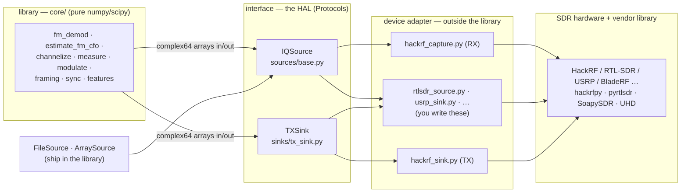

# Adding a new SDR (and keeping the library un-locked)

`sdr_dsp` is deliberately split so the signal processing never knows what radio
produced its samples. This document is the whole hardware-abstraction story in
one place: the layer model and the two contracts (`IQSource` / `TXSink`), the
invariant that keeps the core device-free, the working process for pointing the
library at a radio other than the HackRF One, and the record of which radios
have been checked. The design goal it serves: **the DSP core is
device-agnostic, and no single SDR is special.**

Three artifacts make the claim real and keep it honest:

- `examples/sdr_adapter_template.py` -- a fill-in-the-blanks adapter to copy.
- `tests/test_modularity.py` -- a guard that fails the build if the core ever
  imports a device library, and that drives the pipeline from a non-HackRF
  source.
- this document -- the concept, the step-by-step process, and the porting
  record below.

## The layered model

```
   [ library ]  <->  [ interface ]  <->  [ device adapter ]  <->  [ SDR hardware ]
     core/            IQSource /           examples/ or your        radio + its
     pure DSP         TXSink (a HAL)       code (Adapter pattern)   vendor library
```

The vocabulary for the middle two boxes: the **interface** is a *hardware
abstraction layer* (HAL), expressed here as two Python `Protocol`s (structural,
"duck-typed" contracts). The **device adapter** is the *Adapter design
pattern* -- a small class that satisfies a protocol by wrapping a vendor
library. The core depends on the contract, never on a device; that dependency
inversion is the entire point.



| Layer | What it is | Where it lives | Depends on |
|-------|-----------|----------------|-----------|
| library | Pure DSP: arrays in, arrays out. Knows nothing about radios. | `src/sdr_dsp/core/` | numpy, scipy only |
| interface (HAL) | Two `Protocol`s that define the RX and TX contracts. | `sources/base.py` (`IQSource`), `sinks/tx_sink.py` (`TXSink`) | numpy only |
| device adapter | A class that satisfies a protocol by wrapping a vendor library. | `examples/` or your own code -- **outside** the library | the vendor library |
| SDR hardware | The radio and its driver stack. | n/a (hardware) | -- |

## The two contracts

An adapter only has to provide these attributes and methods. Anything that does
is an `IQSource` / `TXSink` as far as the library is concerned -- no base class
to inherit, no registration.

**Receive -- `IQSource`** (`sources/base.py`):

```python
sample_rate: float      # samples per second (Hz)
center_freq: float      # RF center frequency the samples were captured at (Hz)
def blocks(self) -> Iterator[np.ndarray]:   # yield complex64 blocks
    ...
# A bounded source may also offer read(n); live sources need only blocks().
```

**Transmit -- `TXSink`** (`sinks/tx_sink.py`):

```python
sample_rate: float
center_freq: float
def transmit(self, iq: np.ndarray) -> None: # send one complex64 buffer
    ...
```

### What ships vs. what you write

Ships in the library (device-free, so the whole pipeline is testable with no
radio):

- `ArraySource` -- wrap an in-memory `complex64` array (tests, synthetic signals).
- `FileSource` -- stream a SigMF recording from disk; satisfies `IQSource`, so
  code written against a file runs unchanged against hardware later.
- `LoopbackSink` -- a `TXSink` that "transmits" into an in-memory buffer, so the
  full TX stack (framing -> modulate -> sink) can be exercised without a radio.

You write (per radio, once): an `IQSource` adapter for receive, and/or a
`TXSink` adapter for transmit. The reference adapters to copy are
`examples/hackrf_capture.py` (RX) and `examples/hackrf_sink.py` (TX);
`examples/sdr_adapter_template.py` is the blank form. Everything downstream --
`fm_demod`, `estimate_fm_cfo`, `channelize`, the demod family, framing,
`measure` -- runs against these unchanged.

## Keeping the core device-free

The whole design rests on one invariant: **nothing under `src/sdr_dsp/` may
import a device SDK** (hackrfpy, pyrtlsdr, SoapySDR, uhd, ...). The core
operates on `complex64` arrays and nothing else. Every `hackrfpy` mention in
`src/` is a docstring or a comment. Adapters that talk to hardware live in
`examples/` (or your own code), outside the library.

This is easy to break accidentally (one convenient `import` in a core module),
so it is a checked fact, not a wish:
`tests/test_modularity.py::test_core_imports_no_device_library` AST-scans
`src/sdr_dsp/` and fails if any module imports a library listed in
`DEVICE_LIBS`. If it is green, the library is not locked to any radio, HackRF
included. `examples/` is exempt by design.

## The process

1. **Copy the template.** `cp examples/sdr_adapter_template.py
   examples/<device>_capture.py` (and `_sink.py` if the radio transmits).
   Rename `TemplateSDRSource` to e.g. `RtlSdrSource`.

2. **Fill in the four marked spots** (`>>> FILL IN` in the template):
   1. open/tune/start the device (your vendor library call);
   2. read native samples in a `blocks()` loop;
   3. **normalize the native sample format to `complex64`** -- the step most
      often gotten wrong (see the table below);
   4. transmit only: convert `complex64` back to the device TX format.
   Delete the `_FakeSDR` stand-in once the real device is wired.

3. **Set `sample_rate` and `center_freq` from what the device actually tuned**,
   not from a constant. Downstream measurements (`estimate_fm_cfo`, the pilot
   check, channelizers) trust these.

4. **Register the vendor library** in `tests/test_modularity.py::DEVICE_LIBS`.
   This does two things: it lets the guard confirm the core still doesn't
   import it, and it documents that the SDK is an *adapter-only* dependency.

5. **Verify, in this order:**
   1. *File first.* Point a `FileSource` at a saved capture and run your
      pipeline. This debugs the DSP with zero hardware variables.
   2. *Modularity guard.* `pytest tests/test_modularity.py` -- the core stays
      device-free and a non-HackRF source drives the pipeline.
   3. *Format check.* Confirm your `_to_complex64` maps device midpoint -> ~0
      and full scale -> ~±1 (there's a cu8 example test in test_modularity.py
      to copy for your format).
   4. *Live.* Run the real adapter; compare a live capture against the file
      result. Gate any test that needs the board behind the `hardware` marker.

6. **Record it** in the porting record below, and open an issue or a PR.

## Sample-format normalization (the usual gotcha)

The core only ever sees `complex64` in roughly [-1, 1]. Real radios do not hand
you `complex64` -- each vendor streams its own on-the-wire format, and converting
it is the adapter's job, not the core's. Do the scaling ONCE, inside the
adapter's `blocks()`/`_to_complex64`; never push a device format into the core.

| Radio (vendor lib) | Native format | Normalize to complex64 |
|--------------------|---------------|------------------------|
| HackRF (hackrfpy) | `ci8` (int8) | `(i + 1j*q) / 128.0` |
| RTL-SDR (pyrtlsdr) | `cu8` (uint8, mid 127.5) | `((i - 127.5) + 1j*(q - 127.5)) / 127.5` |
| USRP (uhd) | `cf32` / `sc16` | cast to complex64 / scale int16 by 32768 |
| SoapySDR devices | `CF32` or `CS16` | as above, per the stream format requested |

`src/sdr_dsp/io/sigmf.py` (`load_iq`) is the shipped worked example for `ci8`;
`FileSource` reuses it. A good adapter's `blocks()` also:

- yields `np.ascontiguousarray(..., dtype=np.complex64)` (some vendor buffers
  are views or non-contiguous);
- fills `sample_rate` and `center_freq` from what it actually tuned, not a
  constant;
- handles partial/short reads at the stream tail without raising.

A minimal receive adapter, for scale:

```python
import numpy as np

class RtlSdrSource:                 # structural IQSource; no base class needed
    def __init__(self, dev, sample_rate, center_freq, block_size=65536):
        self._dev = dev             # an opened pyrtlsdr device
        self.sample_rate = float(sample_rate)
        self.center_freq = float(center_freq)
        self.block_size = int(block_size)

    def blocks(self):
        for raw in self._dev.read_bytes_stream(self.block_size):   # cu8
            i = raw[0::2].astype(np.float32); q = raw[1::2].astype(np.float32)
            yield ((i - 127.5) + 1j * (q - 127.5)) / 127.5    # -> complex64
```

## What ports for free vs. what needs work

Porting the **DSP** to a new radio is small and clean. Porting the
**collection tooling** is the part with real work in it. The two are separated
on purpose.

- **Receive + demod: free.** Write an `IQSource`; the entire DSP (filters,
  demod, CFO, channelize, measure, framing) runs unchanged.
- **Transmit: free at the seam.** Write a `TXSink`; the modulate/frame stack
  and `transmit_examples.py` drive it. Keep it guarded (`armed=False`) like
  `examples/hackrf_sink.py`, and prove the stack against `LoopbackSink` first.
- **Auto-gain search: almost free.** See the next section.

### Auto-gain search

Of the *collection* tooling, the gain search is device-agnostic and the probe
layer still is not -- worth stating plainly so nobody assumes more or less than
they get:

- `core/gain_search.py` is split in two layers. `search_gain_model` is the
  general engine: it drives any radio described by a `GainModel` -- named gain
  *stages*, each tagged "frontend" (improves SNR: RF amp, LNA, a tuner's single
  gain) or "level" (sets ADC level after SNR is decided: the HackRF's VGA) --
  through a caller-supplied `probe(settings) -> iq`. `hackrf_gain_model()` and
  `rtlsdr_gain_model()` are the two models that ship; a new radio is a new
  model (data), not new search code. `search_gain` is the HackRF-signature
  wrapper (`probe(lna, vga, amp)`) kept for existing callers; it builds the
  HackRF model and delegates. `examples/gain_search_demo.py` runs the same
  engine against a mock HackRF and a mock RTL-SDR.
- `sources/probe.py` still expects a handle `h` with hackrfpy's `capture(...)`
  signature and routes captures through a file to dodge the Windows pipe
  corruption (see the module docstring). This is the HackRF-shaped piece.
- `tools/preflight_collection.py` builds on both.

Porting a *receiver + demod* path to another SDR needs none of this -- write an
`IQSource` and you are done. Porting *auto-gain search* needs (a) a `GainModel`
for the radio (a few lines of data) and (b) a `probe(settings)` callable that
sets those stages on the device and returns a short capture -- that callable is
the device-specific part, and it lives in your adapter, not in the library.
Write your own probe rather than reusing `sources/probe.py`.

## Porting checklist

- [ ] Write an `IQSource` adapter; normalize the device format to `complex64` in
      `blocks()`.
- [ ] Set `sample_rate` / `center_freq` from what was actually tuned.
- [ ] (If transmitting) write a `TXSink` adapter; prove the stack against
      `LoopbackSink` first, then swap in the device.
- [ ] Register the vendor library in `test_modularity.py::DEVICE_LIBS`.
- [ ] Validate against a file first: run the pipeline through `FileSource` on a
      saved capture, then against the live adapter -- output should match.
- [ ] Leave `core/` untouched. If you found yourself editing it, the seam moved
      to the wrong place.
- [ ] Only if you need auto-gain: write a `GainModel` for the radio and a
      `probe(settings)` callable, and call `search_gain_model`. Otherwise set
      gains manually in the adapter.

## Porting record

One row per radio, updated as each is added. "Modularity guard" = the file-first
+ `test_modularity.py` checks pass; "Live verified" = tested against the board.

| SDR | Vendor lib | Native fmt | RX | TX | Adapter file | Modularity guard | Live verified | Notes |
|-----|-----------|-----------|----|----|--------------|------------------|---------------|-------|
| HackRF One | hackrfpy | ci8 | ✅ | ⚠️ guarded | `examples/hackrf_capture.py`, `hackrf_sink.py` | ✅ | ✅ (RX; FM by ear) | reference adapter; TX device call left for bench |
| _(template)_ | _(fake cu8)_ | cu8 | ✅ | ⚠️ guarded | `examples/sdr_adapter_template.py` | ✅ | n/a (no hardware) | self-demo proves the seam; copy this |
| _RTL-SDR_ | _pyrtlsdr_ | _cu8_ | _—_ | _n/a (RX-only)_ | _—_ | _—_ | _—_ | _example next target; copy the template_ |

Copy the last row and fill it in for your radio. Keep this table honest -- a ✅
in "Modularity guard" should mean the tests actually pass on your tree.

---

*The abstractions above are real and enforced today. The gain-search engine is
shipped and tested against mock radios; only the probe layer
(`sources/probe.py`) remains HackRF-shaped. See `sources/base.py`,
`sinks/tx_sink.py`, `core/gain_search.py`, and `examples/hackrf_capture.py` for
the authoritative reference.*
